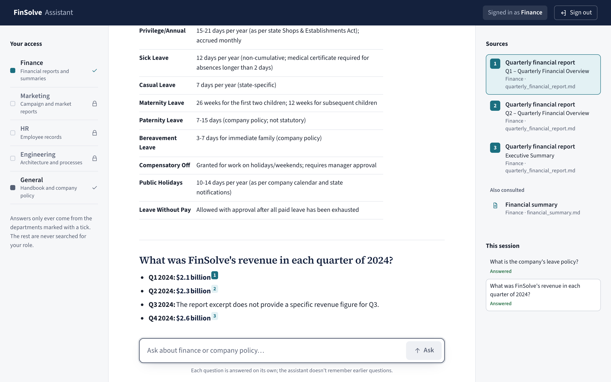
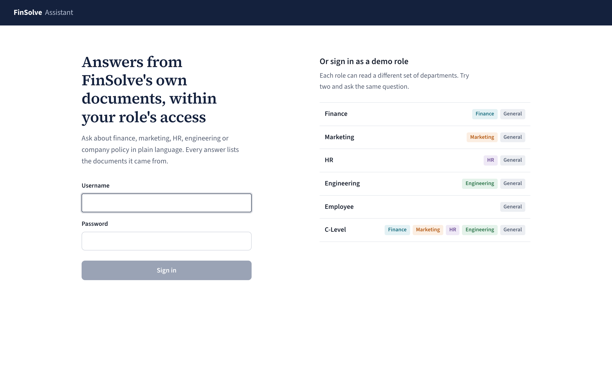
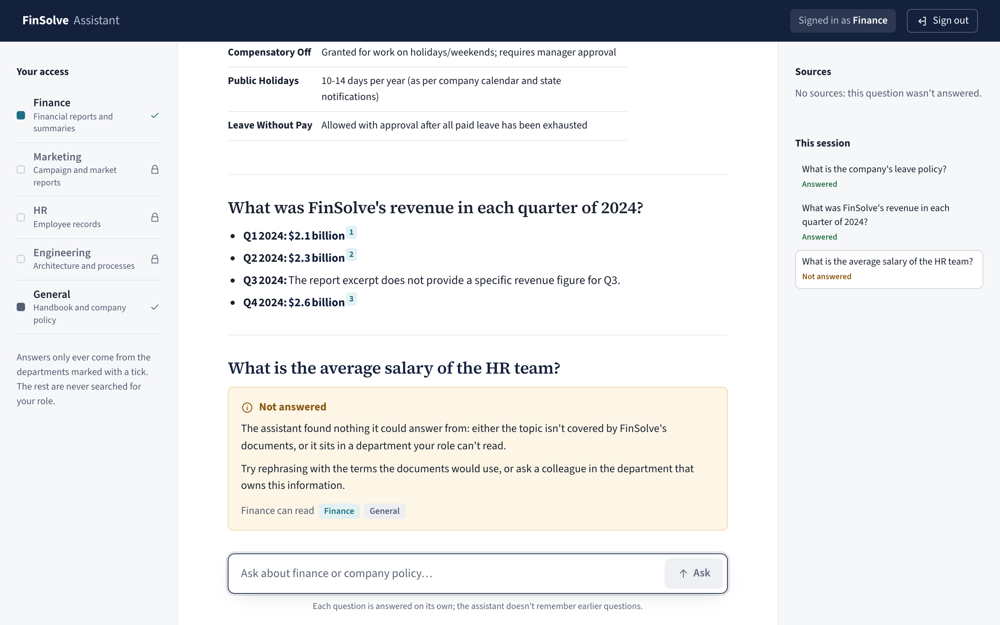

# FinSolve Assistant: a RAG chatbot with role-based access control

An internal assistant for a fictional fintech company, FinSolve Technologies. Employees ask questions in plain language and get answers grounded in the company's own documents: finance reports, marketing reports, HR records, engineering docs and the employee handbook. **Each answer only ever draws on the documents the employee's role is allowed to read**, and it cites the documents it used.



## Why it's built this way

- **Access control is enforced at retrieval, not in the prompt.** Every chunk is tagged with its department. A user's question only ever searches their role's departments, so restricted text never reaches the model. Telling a model "don't reveal HR data" is not a guarantee; never retrieving it is.
- **Every answer is cited.** The model's inline citations become numbered notes linked to a Sources panel, with the document and section they came from.
- **Declining is a correct outcome.** When the documents don't support an answer, the assistant says so rather than guessing.
- **Every retrieval change is measured.** An evaluation harness scores each change, and every experiment is logged with its numbers in [docs/EXPERIMENTS.md](docs/EXPERIMENTS.md).

## Results

Measured on a hand-written test set of 30 questions, covering every role and question type. 24 of the questions should be answered; the other 6 should be refused or flagged as out of scope.

| Metric | Baseline (EXP-000) | Current (EXP-003) |
|---|---|---|
| Retrieval: share of the needed evidence found in the top 5 chunks | 56% | **81%** |
| Retrieval: same, top 15 | 69% | **91%** |
| Answers containing every key fact | 33% | **50%** |
| Simple fact questions fully correct | 55% | **73%** |
| Average share of key facts per answer | 43% | **66%** |
| Confidently wrong counts ("how many employees…") | 2–3 per run | **0** |
| Cross-role data leaks / wrong refusals | 0 | **0** (in every run) |
| Cost per question | | **≈ $0.00025** |

The test set is small: each answerable question is worth about 4 percentage points, and repeated runs vary by about ±2 questions. What moved the numbers, in order:

1. **Larger chunks**: 250 → 800 characters, so figures stay together with their labels.
2. **Hybrid search**: BM25 keyword search combined with dense embedding search through reciprocal rank fusion.
3. **Contextual chunk headers**: section headings were being stripped into metadata where no search could see them. This was the biggest single gain.
4. **A prompt rule against counting**: the model was counting the few records it retrieved and reporting that as a total.

Each step has its hypothesis, row-level results and decision in [docs/EXPERIMENTS.md](docs/EXPERIMENTS.md).

## Architecture

```
Sign in ──► FastAPI /login ──► bcrypt check (users.yaml) ──► JWT with the role claim

Question ──► FastAPI /chat (JWT verified)
              1. Scope guardrail     relevance score; an LLM classifier for borderline cases
              2. Hybrid retrieval    dense (Chroma, bge-base) + BM25, both limited to
                                     the role's departments, fused with RRF, top 5
              3. Generation          Groq gpt-oss-120b, cite-every-claim prompt
              4. PII redaction       salary, email, dates and employee IDs masked for roles without HR access
              5. Monitoring          LangSmith trace; tokens, cost and latency → Postgres;
                                     daily cost threshold → one alert email
              ──► { answer, sources }
```

**Ingestion:** markdown is split by headings, then into 800-character chunks with 150 characters of overlap. Each chunk is prefixed with its heading path (for example `Employee Handbook > Leave Policies`). The HR CSV becomes one document per employee. Everything is embedded locally with `BAAI/bge-base-en-v1.5` into Chroma, tagged with its department.

### Roles and access

| Role | Can read |
|---|---|
| Finance | Finance, General |
| Marketing | Marketing, General |
| HR | HR, General |
| Engineering | Engineering, General |
| Employee | General |
| C-Level | Everything |

The mapping lives in [app/core/roles.py](app/core/roles.py), the single source of truth.

## Tech stack

| Layer | Choice |
|---|---|
| Backend | FastAPI, LangChain |
| LLM | `openai/gpt-oss-120b` on Groq |
| Retrieval | ChromaDB + `BAAI/bge-base-en-v1.5` (local), `rank-bm25`, reciprocal rank fusion |
| Auth | bcrypt-hashed users + JWT |
| Frontend | React, Vite, TypeScript; GFM markdown rendering, sanitised |
| Monitoring | LangSmith tracing; Supabase Postgres cost and latency log; SMTP email alerts |
| Evaluation | Custom three-tier harness, plus optional Ragas |

## Evaluation harness

| Tier | Command | What it checks | LLM calls |
|---|---|---|---|
| 1. Retrieval | `python -m eval.retrieval_check` | Are each question's evidence strings in the top-k chunks? Deterministic. | 0 |
| 2. Answers | `python -m eval.run_evals` | Does each answer contain its key facts (pass / partial / fail)? | ~28 |
| Hard gates | (part of tier 2) | No cross-role leaks; correct refusals and out-of-scope handling | — |
| 3. Ragas | `python -m eval.run_evals --ragas` | LLM-judged faithfulness and correctness, for milestones only | ~200 |

Every run saves a results file recording the git commit, a flag for uncommitted changes, the configuration, the index's chunk count and a hash of the dataset, so any number can be traced back to the code that produced it. Tiers 1 and 2 need no LLM judge, so they fit within free-tier API limits.

## Run it locally

Requires Python 3.11+, Node 18+, and a [Groq](https://console.groq.com) API key.

```bash
# Backend
python -m venv venv && source venv/bin/activate
pip install -e ".[dev]"
cp .env.example .env                 # set GROQ_API_KEY and JWT_SECRET_KEY at minimum
python -m app.ingestion.build_index  # embed data/ into the local Chroma index
uvicorn app.main:app --reload        # http://localhost:8000

# Frontend (second terminal)
cd frontend && npm install && npm run dev   # http://localhost:5173
```

The sign-in page has one-click buttons for six demo roles, so you can ask the same question as two roles and compare. The demo accounts are listed in [users/users.yaml](users/users.yaml) and are for local use only.

Optional settings in `.env`:
- `DATABASE_URL` (any Postgres; Supabase works) turns on cost and latency logging.
- The `SMTP_*` and `ALERT_EMAIL_TO` settings turn on the daily cost alert email.
- `LANGCHAIN_*` turns on LangSmith tracing.

The app runs without any of them.

## Known limitations

- **Counting and totals aren't supported.** "How many employees are in Sales?" needs all 100 HR records, but retrieval returns 5. The assistant now declines these instead of guessing. A real fix needs a structured path, such as precomputed summaries or a SQL tool.
- **Multi-part questions are sometimes answered only partly.** If one quarter's figure isn't retrieved, the answer says so rather than inventing it (see the screenshot above).
- **Each question is answered on its own.** There is no memory across turns, and the UI says so.
- **The source data contradicts itself in places.** For example, the founding year is 2016 in the handbook and 2018 in the engineering doc. Answers follow whichever document the role can see.
- **The test set is small** (24 answerable questions). The numbers show direction, not precision.

| Sign-in with demo roles | A declined question |
|---|---|
|  |  |

## Roadmap

- [ ] Docker images, CI (unit tests plus the retrieval check as a gate) and deployment to Azure Container Apps
- [ ] Cross-encoder reranker over the fused top 20, to close the remaining gap between top-5 and top-15 retrieval
- [ ] A structured path for aggregate questions

## Repository layout

```
app/          FastAPI backend: api, core (config, security, roles), ingestion, rag, guardrails, monitoring
frontend/     React + Vite + TypeScript UI
eval/         Test set, three-tier evaluation harness, results
data/         Source documents, one folder per department
docs/         EXPERIMENTS.md (experiment log), screenshots
users/        Demo users (bcrypt hashes)
```
